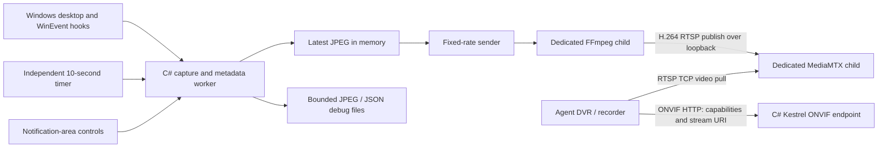

# DART design

## Components and data flow

One visible Windows Forms tray application owns the capture worker, ONVIF HTTP server and native child processes. FFmpeg and MediaMTX are separate OS processes supervised by DART, not libraries hosted inside the C# process and not shared machine services. A session-local mutex permits one DART host per Windows session. Installation registers an all-user logon startup entry; the app needs an interactive user desktop for capture.

## Capture scheduling

`Program.cs` registers out-of-context WinEvent hooks for foreground changes (event 3) and move/size completion (event 11). The delegate remains rooted and the Windows Forms message loop dispatches notifications. Events coalesce into one pending capture with a 750 ms settling period and a three-second event-capture minimum interval. The first pending event sets the settling deadline; repeated events do not postpone it indefinitely.

An independent deadline triggers capture every 10 seconds while the desktop is available, regardless of event activity. This catches passive video playback without turning every movie repaint into a trigger. It is not a real-time deadline guarantee. Startup, display changes, session return and the tray's Capture now also request captures.

GDI CopyFromScreen captures the combined virtual-screen rectangle, including negative monitor coordinates. PerMonitorV2 DPI awareness supplies physical screen pixels. No cursor is drawn. Visible top-level windows are enumerated with title, HWND, process ID, screen rectangle, foreground state, enumeration order and minimized/cloaked state. This is not an inventory of every hidden HWND, browser tab or child control. Metadata enumeration and pixel capture are sequential, with timestamps indicating the capture interval.

Lock/disconnect notifications or an unavailable desktop replace the stream with a placeholder. Capture failures also produce a placeholder and log error. Historical debug snapshots remain. Disconnected/headless RDP, secure desktops, protected content, multiple simultaneous sessions and mixed monitor/DPI configurations require target-machine testing.

## Debug metadata and retention

The latest frame is held in memory. Numbered JPEG/JSON pairs are also written to the current user's LocalAppData session directory. Only after both writes finish is `latest.json` replaced with a pointer to that pair. The latest 20 image/metadata pairs are retained; logs rotate at about 2 MB with one previous file.

JSON is embedded in a custom JPEG XMP APP1 property (`urn:dart:metadata:1`, `jsonBase64`) if it fits the 65,533-byte APP1 payload limit. Otherwise the sidecar remains available. Readers of retained files should retry if a pair is retired during access. Neither this XMP property nor the JSON sidecar is carried as ONVIF timed metadata in the video stream.

## Continuous video

A separate sender repeats the most recent complete JPEG through FFmpeg stdin at `FrameRate`, default 5 fps. The encoder does not poll partially written files. Event-driven screenshots and output video cadence are independent.

FFmpeg decodes MJPEG input, scales/letterboxes to 1920×1080, and encodes H.264 Main, yuv420p with libx264 and a two-second GOP. Default target bitrate is 1000 kbps, with VBV and CBR filler. Static desktop frames therefore still produce a regular encoded timeline. Scheduling, buffer startup and network overhead affect observed rates. Large multi-monitor desktops lose text detail at this fixed output size.

MediaMTX accepts loopback publishing to `/desktop` and serves RTSP over TCP. Localhost read/publish permissions support the encoder and local readers. Remote readers must use DART's camera credentials. Other MediaMTX services are disabled in the generated configuration. A stream failure retries; children are assigned to a Windows kill-on-close job and stopped on normal exit/logoff. A small process-start/job-assignment race remains.

## ONVIF control and authentication

`OnvifHost.cs` hosts a read-only Device/Media1 SOAP subset with Kestrel. It reports the fixed encoding profile and returns RTSP and snapshot URIs. Optional LAN WS-Discovery handles Probe/ProbeMatches; direct service-URL entry also works. See [ONVIF.md](../ONVIF.md) for exact operations and unsupported methods.

HTTP Basic and WS-Security UsernameToken PasswordDigest are implemented, including nonce replay and timestamp checks. HTTP Digest and PasswordText are not implemented. This is not a certified ONVIF Profile S/T device. ONVIF supplies control/discovery; RTSP carries the video. DART does not create a cloud account or upload to a cloud ONVIF endpoint by itself: the recorder pulls the reachable stream, or a separate adapter uploads it.

## Configuration and installer

`CameraSettings.cs` loads per-session `camera.json`, preserving credentials, UUID and configured ports. LAN binding/discovery are always enabled, including legacy localhost-only installations. An explicit non-local advertised hostname is retained; localhost is replaced with an automatically selected LAN IPv4 address when possible. Settings changes require restart. Credentials and generated MediaMTX configuration are plaintext files under the user's LocalAppData.

NSIS installs an x64 self-contained .NET bundle, native tools, notices, shortcuts and HKLM logon startup. Elevated PowerShell configures executable-scoped firewall rules for all Windows profiles. The default scope is LocalSubnet; the final-page internet option selects Any. A temporary Interactive/Limited scheduled task launches DART as the desktop user after install and is then unregistered. Uninstall retains per-user runtime data.

Version 0.3.2 enumerates existing firewall rules and filters locally, avoiding a CIM no-match error when there are no blocking rules. Application filters are resolved before deleting blocks. Genuine firewall-access errors remain installation failures.

## Source map

| File | Responsibility |
|---|---|
| `src/Dart/Program.cs` | Tray, hooks, capture scheduling, debug publishing and lifecycle |
| `src/Dart/Desktop.cs` | Windows capture/session/window P/Invoke helpers |
| `src/Dart/CameraSettings.cs` | Persistent camera settings and LAN advertisement |
| `src/Dart/StreamHost.cs` | FFmpeg/MediaMTX configuration, supervision and frame input |
| `src/Dart/ChildProcessJob.cs` | Native child lifetime ownership |
| `src/Dart/OnvifHost.cs` | ONVIF HTTP/SOAP, authentication, snapshots and discovery |
| `src/Dart/ConnectionDetailsForm.cs` | Copyable addresses, ports and credentials |
| `installer/Dart.nsi` | Installer pages, startup registration and uninstall |
| `installer/Configure-Firewall.ps1` | Scoped firewall creation/repair/removal |
| `installer/Launch-Dart.ps1` | Non-elevated post-install user launch |

HTTP/RTSP are unencrypted. The visible tray provides access to status and Exit; the app does not implement a management console, central policy enforcement, encrypted credential storage or a metadata-search server.
